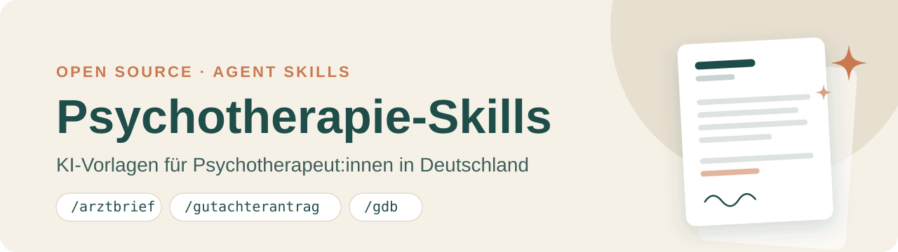

# Psychotherapy Skills – AI templates for psychotherapists in Germany

[🇩🇪 Deutsch](README.md) · 🇬🇧 English

Templates in the open [Agent Skills format](https://agentskills.io) (`SKILL.md`) for recurring paperwork in psychotherapy practice: reports, applications, handouts. Works with Claude Code, OpenAI Codex, GitHub Copilot, Cursor, Gemini CLI and other AI assistants that support skills. The assistant asks for missing details, writes a draft to your storage folder and revises it with you.

⭐ **Find this useful?** A star (top right) helps colleagues discover the project. Ideas for new templates are welcome as an [issue](https://github.com/ChristophWeigert/ki-psychotherapie-praxis/issues).

**Scope:** Germany (statutory health insurance/GKV, Psychotherapy Guideline, PTV forms), all federal states. The templates themselves and all generated documents are in German. They do not fit Austria or Switzerland without adaptation (different insurance, application and authority procedures).

## Skills

| Command | Purpose | Region |
|---|---|---|
| `/arztbrief` | Report to referring/co-treating physicians | DE |
| `/gutachterantrag-umwandlung-vt` | Report to the insurance reviewer (PTV 3), converting short-term to long-term therapy, CBT | DE |
| `/indikationsschreiben-mastektomie` | Indication letter for mastectomy in gender incongruence (S3 guideline AWMF 138/001) | DE |
| `/hoeherstufung-gdb` | Statement supporting a higher degree of disability (GdB) to the pension/disability office | DE (authority depends on state) |
| `/handout-suizidalitaet` | Patient handout with a regional crisis/safety plan | DE (crisis services/clinics depend on location) |

Regional details: the skills take the federal state from `praxis.md` (otherwise they ask). `/hoeherstufung-gdb` addresses the responsible authority (Bavaria: ZBFS, elsewhere the state or pension office) as stated in the notice. `/handout-suizidalitaet` uses Krisendienst Bayern in Bavaria, elsewhere a regional crisis service or 116 117 as a fallback, and suggests clinics near the patient's home. Always check suggested numbers, addresses and clinics before handing anything out.

Skills only run when you call them explicitly (in Claude Code via `/command`, in other tools via their skill invocation or e.g. "Use the skill arztbrief").

## Setup

**Claude Desktop (automatic updates):** Customize → Plugins → Personal → "+" → Add marketplace from GitHub, paste `ChristophWeigert/ki-psychotherapie-praxis`, click Sync, then install **psychotherapie-praxis**. Updates arrive automatically. Claude Code: `/plugin marketplace add https://github.com/ChristophWeigert/ki-psychotherapie-praxis.git`, then `/plugin install psychotherapie-praxis@ki-psychotherapie-praxis`.

**Codex:** `codex plugin marketplace add ChristophWeigert/ki-psychotherapie-praxis`, then `codex plugin add psychotherapie-praxis@ki-psychotherapie-praxis`; update with `codex plugin marketplace upgrade`. **Cursor:** open the folder (below), or import the repo as a team marketplace under Plugins → Import.

With the plugin, your files live in `Documents/Praxis-KI` unless you choose a different folder the first time.

**Other tools (folder, e.g. Claude Desktop, Cursor):** For Codex, use the plugin above; Codex does not find the skills in folder mode.

1. **Download:** [Download ZIP](https://github.com/ChristophWeigert/ki-psychotherapie-praxis/archive/refs/heads/main.zip) and unzip, e.g. to `Documents/ki-psychotherapie-praxis`.
2. **Open:** Open the folder in your AI assistant (e.g. Claude Desktop, Cursor).
3. **Start:** Type `/arztbrief` and paste your material (notes, prior findings) or point to a file. The first time, the assistant asks where your files should live (suggestion: `Documents/Praxis-KI`) and creates your practice details (`praxis.md`) and a `berichte/` folder there. Some assistants ask for permission the first time they save outside the opened folder – confirm once.

**Even easier:** Tell your assistant: "Download https://github.com/ChristophWeigert/ki-psychotherapie-praxis and open the folder." (not for Codex)

**Updating:** Download the new ZIP, unzip, delete the old folder. Your practice details and drafts stay in your storage folder; the assistant asks for its path once more.

Skills live in `.claude/skills/`, shared rules in `AGENTS.md`. If your tool expects skills in a different folder, see its documentation.

## Privacy – please read

- **Patient data leaves your computer.** Everything you enter is sent to the AI model provider for processing (e.g. Anthropic, OpenAI, Google, Microsoft). Before using real data, check GDPR (Art. 9, Art. 28 – data processing agreement) and your duty of confidentiality (§ 203 German Criminal Code). Private consumer accounts usually have no data processing agreement; for real treatment data you need a business/enterprise or API account with one and without training on your data. Without a data processing agreement, enter only fully anonymised or fictional cases. Even with an agreement, always pseudonymise (code, initials, no address/date of birth – add real data only in the finished document in your practice software); pseudonymised data still counts as personal data under GDPR, because life history and context can identify a person.
- Drafts and practice details live in your storage folder, not in this folder. Don't put the storage folder in cloud storage without a data processing agreement and **never** upload it to GitHub or similar.
- Every draft is a draft: review it professionally; responsibility stays with you.

## Adding your own skills

Create a new folder `.claude/skills/<name>/SKILL.md`, ideally by copying an existing template. Shared rules (language, gender-inclusive wording, storage location) are in [AGENTS.md](AGENTS.md) and don't need repeating in each skill; but keep the template's reference to `AGENTS.md` so the rules also apply when installed as a plugin. Mark region-specific content (crisis services, pension offices) in the skill name or description.

## License

[MIT](LICENSE)
