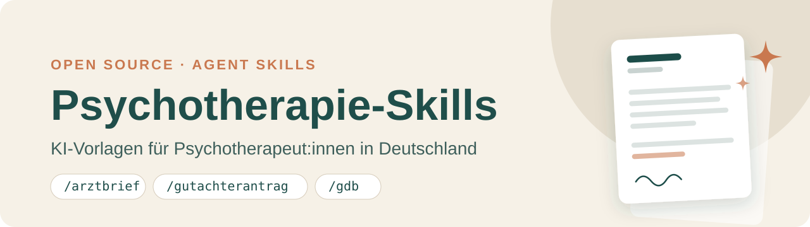

# Psychotherapie-Skills – KI-Vorlagen für Psychotherapeut:innen in Deutschland

Vorlagen im offenen [Agent-Skills-Format](https://agentskills.io) (`SKILL.md`) für wiederkehrende Schreibarbeit in der psychotherapeutischen Praxis: Berichte, Anträge, Handouts. Nutzbar mit Claude Code, OpenAI Codex, GitHub Copilot, Cursor, Gemini CLI und anderen KI-Assistenten, die Skills unterstützen. Der Assistent fragt fehlende Angaben ab, schreibt einen Entwurf in deinen Ablageordner und überarbeitet ihn mit dir.

> **English:** Open-source AI agent skills for psychotherapists in Germany – doctor's letters, insurance reports (PTV 3), disability (GdB) statements, safety plans. → [Read in English](README.en.md)

⭐ **Hilft dir das?** Ein Stern oben rechts macht das Projekt für Kolleg:innen sichtbarer. Ideen für neue Vorlagen gern als [Issue](https://github.com/ChristophWeigert/ki-psychotherapie-praxis/issues).

**Geltungsbereich:** Deutschland (GKV, Psychotherapie-Richtlinie, PTV-Formulare), alle Bundesländer. Für Österreich und die Schweiz passen die Vorlagen nicht ohne Anpassung (andere Kassen-, Antrags- und Behördenwege).

## Skills

| Befehl | Zweck | Region |
|---|---|---|
| `/arztbrief` | Bericht an überweisende/mitbehandelnde Ärzt:innen | DE |
| `/gutachterantrag-umwandlung-vt` | Bericht an Gutachter (PTV 3), Umwandlung KZT → LZT, VT | DE |
| `/indikationsschreiben-mastektomie` | Indikation Mastektomie bei Geschlechtsinkongruenz (S3-LL AWMF 138/001) | DE |
| `/hoeherstufung-gdb` | Stellungnahme zur GdB-Höherstufung bei der Versorgungsbehörde | DE (Behörde je nach Bundesland) |
| `/handout-suizidalitaet` | Handout mit regionalem Notfallplan | DE (Krisendienst/Kliniken je nach Wohnort) |

Regionale Angaben: Die Skills übernehmen das Bundesland aus `praxis.md` (sonst fragen sie nach). `/hoeherstufung-gdb` adressiert die zuständige Behörde (Bayern: ZBFS, sonst Landes- bzw. Versorgungsamt) laut Bescheid. `/handout-suizidalitaet` nutzt in Bayern den Krisendienst Bayern, anderswo einen regionalen Krisendienst oder ersatzweise 116 117, und schlägt Kliniken am Wohnort vor. Vorgeschlagene Nummern, Adressen und Kliniken vor der Ausgabe immer prüfen.

Die Skills starten nur, wenn du sie ausdrücklich aufrufst (in Claude Code per `/befehl`, in anderen Werkzeugen über deren Skill-Aufruf oder z.B. „Nutze den Skill arztbrief“).

## Einrichtung in Claude Desktop – mit automatischen Updates

1. In Claude Desktop **Anpassen → Plugins → Persönlich → „+“ → Marktplatz von GitHub hinzufügen** öffnen.
2. `ChristophWeigert/ki-psychotherapie-praxis` einfügen und **Synchronisieren** klicken. Die Warnung, dass das Plugin nicht von Anthropic stammt, bestätigen.
3. Das Plugin **psychotherapie-praxis** installieren. Updates kommen danach von selbst.

In Claude Code reicht: `/plugin marketplace add https://github.com/ChristophWeigert/ki-psychotherapie-praxis.git`, dann `/plugin install psychotherapie-praxis@ki-psychotherapie-praxis`.

**Codex:** `codex plugin marketplace add ChristophWeigert/ki-psychotherapie-praxis`, dann `codex plugin add psychotherapie-praxis@ki-psychotherapie-praxis`. Updates holen: `codex plugin marketplace upgrade`.

**Cursor:** Einzelpersonen öffnen am einfachsten den Ordner (siehe unten). Teams können das Repo im Cursor-Dashboard unter *Plugins → Import* als Team-Marktplatz einbinden.

Bei der Plugin-Variante liegen deine Unterlagen in `Dokumente/Praxis-KI`, außer du gibst beim ersten Mal einen anderen Ordner an.

## Einrichtung als Ordner – für Codex, Cursor u. a.

1. **Herunterladen:** [ZIP herunterladen](https://github.com/ChristophWeigert/ki-psychotherapie-praxis/archive/refs/heads/main.zip) und entpacken, z. B. nach `Dokumente/ki-psychotherapie-praxis`.
2. **Öffnen:** Den Ordner in deinem KI-Assistenten öffnen (z. B. Claude Desktop, Codex, Cursor).
3. **Loslegen:** `/arztbrief` eingeben und Unterlagen (Notizen, Vorbefunde) hineinkopieren oder als Datei angeben. Beim ersten Mal fragt der Assistent, wo deine Unterlagen liegen sollen (Vorschlag: `Dokumente/Praxis-KI`), und legt dort deine Praxisangaben (`praxis.md`) und den Ordner `berichte/` an. Manche Assistenten fragen beim ersten Speichern außerhalb des geöffneten Ordners um Erlaubnis – einmal bestätigen.

**Noch einfacher:** Sag deinem Assistenten: „Lade https://github.com/ChristophWeigert/ki-psychotherapie-praxis herunter und öffne den Ordner.“

**Aktualisieren:** Neue ZIP herunterladen, entpacken, alten Ordner löschen. Deine Praxisangaben und Entwürfe bleiben im Ablageordner; der Assistent fragt nur einmal erneut nach dessen Pfad.

Die Skills liegen unter `.claude/skills/`, gemeinsame Regeln in `AGENTS.md`. Erwartet dein Werkzeug die Skills in einem anderen Ordner, siehe dessen Dokumentation.

## Datenschutz – bitte lesen

- **Patientendaten verlassen deinen Rechner.** Alles, was du eingibst, wird zur Verarbeitung an den Anbieter des KI-Modells übertragen (z.B. Anthropic, OpenAI, Google, Microsoft). Prüfe vor dem Einsatz mit echten Daten DSGVO (Art. 9, Art. 28 – Auftragsverarbeitungsvertrag) und deine Schweigepflicht (§ 203 StGB). Private Consumer-Konten haben in der Regel keinen AVV; nutze ein Business/Enterprise- oder API-Konto mit AVV und ohne Datenspeicherung zu Trainingszwecken, oder arbeite nur mit **pseudonymisierten** Daten (Chiffre, Initialen, keine Adresse/Geburtsdatum – Echtdaten erst im fertigen Dokument in deiner Praxissoftware ergänzen).
- Entwürfe und Praxisangaben liegen in deinem Ablageordner, nicht in diesem Ordner. Lege den Ablageordner nicht in einen Cloud-Speicher ohne AVV und lade ihn **nie** auf GitHub o.Ä. hoch.
- Jeder Entwurf ist ein Entwurf: fachlich prüfen, Verantwortung bleibt bei dir.

## Eigene Skills ergänzen

Neuer Ordner unter `.claude/skills/<name>/SKILL.md`, am besten eine bestehende Vorlage kopieren. Gemeinsame Regeln (Sprache, Gendern, Speicherort) stehen in [AGENTS.md](AGENTS.md) und müssen nicht in jedem Skill wiederholt werden. Regional gebundene Inhalte (Krisendienste, Versorgungsämter) im Skill-Namen oder in der Beschreibung kennzeichnen.

## Lizenz

[MIT](LICENSE)
